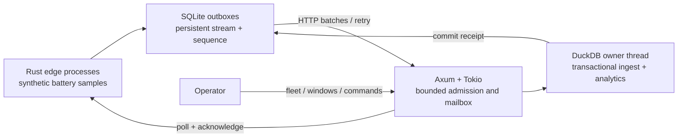

# GridStream

[](https://github.com/YashVG/gridstream-rs/actions/workflows/ci.yml)

A Rust lab for collecting battery telemetry over unreliable connections, querying it with DuckDB, and delivering expiring simulated power commands. Edge processes keep a durable outbox; the server acknowledges a batch only after its samples, sequence checkpoint, and retry receipt commit together.



## What it demonstrates

- **Durable replay:** stable stream identities, ordered batches, duplicate detection, and rejection of changed retries or sequence gaps.
- **Backpressure:** bounded admitted requests and storage work, HTTP `503` with `Retry-After`, and edge retries with exponential backoff and jitter.
- **Energy analytics:** event-time fleet power and battery charge snapshots, stale-device exclusion, and sample-weighted time windows in DuckDB SQL.
- **Control lifecycle:** separate operator credentials, fresh-telemetry checks, per-device command generations, expiry, and persistent simulated application records.
- **Verification:** Rust contract/HTTP tests, a real-process failure scenario, and a concurrent Rust load generator that measures commit latency and verifies database counts.

## Run the failure demo

Requirements: Rust via [rustup](https://rustup.rs/), a C compiler, Python 3.9+, `curl`, `tar`, and `shasum`. macOS and glibc Linux on ARM64/x86_64 are supported by the runtime script. Rust is pinned in `rust-toolchain.toml`; the script downloads and SHA-256-verifies the official DuckDB 2.0.0 library. No Docker or cloud account is needed.

```sh
./scripts/cargo.sh build --release --locked --bins
python3 scripts/scenario.py
python3 scripts/benchmark.py
```

The scenario creates temporary databases and random credentials, drops an acknowledgement after commit, kills the server with `SIGKILL`, restarts it, and checks replay, concurrent edges, command expiry, and analytics. It cleans up its processes and databases. Success prints nine passed checks and **125 committed samples**.

```sh
./scripts/cargo.sh test --locked
./scripts/cargo.sh clippy --locked --all-targets -- -D warnings
./scripts/cargo.sh fmt --check
```

## Read next

- [Architecture and guarantees](docs/architecture.md): transaction boundaries, ordering, and failure tradeoffs.
- [API and interactive use](docs/api.md): run an edge/server pair and query telemetry.
- [Measured results](docs/results.md): reproducible workload, raw measurements, and limitations.

This project explores streaming IoT, Rust, DuckDB, and reliability testing relevant to [distributed energy software](https://www.tesla.com/careers/search/job/internship-distributed-systems-software-engineer-energy-engineering-winter-spring-2027-285508). It uses synthetic data and simulated setpoints. Storage is a single local DuckDB instance; there is no replication, consensus, hardware control, or production-scale claim. See the architecture notes before exposing the service beyond localhost.

MIT licensed.
