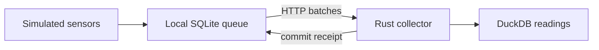

# Sensor Relay

[](https://github.com/YashVG/sensor-relay/actions/workflows/ci.yml)

A small Rust project for learning how to send sensor readings between processes when connections drop, responses get lost, and programs restart.

The setup is intentionally simple: simulated temperature sensors send batches to a collector, and DuckDB stores the readings for SQL queries. Each sensor keeps a local SQLite queue until the collector confirms a batch. That creates a useful problem to study: a failed request does not always mean the server failed to save the data.



## Things to experiment with

- Stop the collector, generate readings, and replay them after it comes back.
- Drop a response after a successful write and see why retrying needs a stable batch identity.
- Shrink the collector's queue and observe rejection, backoff, and latency.
- Send old readings and compare a latest-sensor snapshot with a time-window average.

Rust and Tokio handle the client/server processes. SQLite makes the pending queue survive restarts. DuckDB keeps the query side small enough to inspect directly. [The design notes](docs/architecture.md) explain the choices and their limits.

## Try it

Requirements: [rustup](https://rustup.rs/), a C compiler, Python 3.9+, `curl`, `tar`, and `shasum`. The build script supports macOS and glibc Linux on ARM64/x86_64. It fetches a checksum-verified DuckDB 2.0.0 library; Rust is pinned in `rust-toolchain.toml`.

```sh
./scripts/cargo.sh build --release --locked --bins
python3 scripts/scenario.py
```

The scenario runs actual client/server processes, disconnects a client after a committed write, kills and restarts the collector, then checks the recovered data. It uses temporary files and prints seven passed checks with 125 saved readings.

For a smaller manual experiment, follow [the two-terminal walkthrough](docs/api.md). For focused exercises, see [experiments](docs/experiments.md).

```sh
./scripts/cargo.sh test --locked
python3 scripts/benchmark.py
```

[Benchmark notes](docs/results.md) include the workload and raw results. The sensors are simulated; the measurements are from one laptop over localhost. The collector is a single process with a single database, and all queries share its storage worker. Real hardware, replication, and long-running deployment are possible follow-up projects.

MIT licensed.
